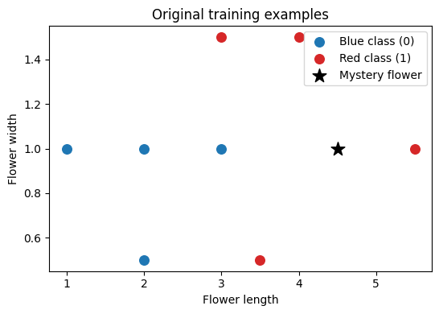
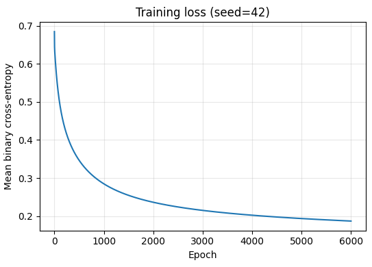
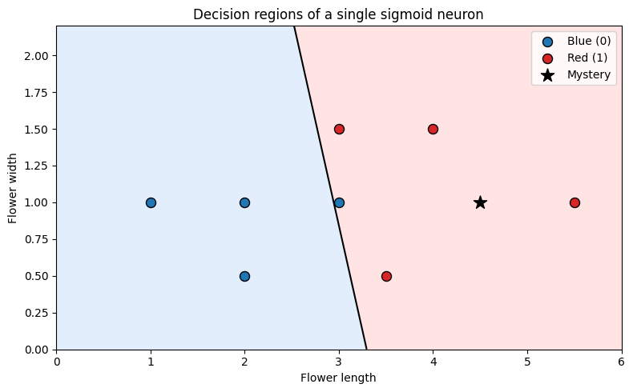

# Deep Learning for NLP — Neural Network Foundations

**Reproducible machine learning from first principles: a tested NumPy binary classifier, interactive Jupyter notebook, and automated GitHub Actions checks.**

[](https://www.python.org/)
[](https://numpy.org/)
[](https://jupyter.org/)
[](https://github.com/g25ait2138-collab/Deep-Learning-for-NLP/actions/workflows/python-tests.yml)

## Overview

This repository documents a **from-scratch binary classification** exercise using Python, NumPy, and Jupyter. Its featured example learns from two numerical flower features (`length`, `width`) to predict one of two **synthetic classroom labels**: blue (`0`) or red (`1`).

The implemented model is **one sigmoid neuron (logistic regression)**. It is **not** a multilayer deep network, real flower-species recognizer, image classifier, or trained NLP model. The repository builds foundational skills that can later be applied to larger neural networks and natural language processing projects.

**Start here:** [Run the reproducible notebook in Google Colab](https://colab.research.google.com/github/g25ait2138-collab/Deep-Learning-for-NLP/blob/main/notebooks/flowers_classification.ipynb) · [View model source](src/flower_classifier.py) · [View unit tests](tests/test_flower_classifier.py) · [View technical review](docs/technical_review.md)

## Highlights

- **From-scratch ML implementation:** sigmoid activation, binary cross-entropy (BCE), and full-batch gradient descent using NumPy.
- **Reproducibility:** fixed random seed (`42`), documented hyperparameters, and a self-contained Colab notebook.
- **Numerical stability:** overflow-resistant sigmoid and loss computed in logit space with `numpy.logaddexp`.
- **Testing:** six `unittest` test cases covering stable computation, deterministic training, prediction, loss reduction, and invalid input.
- **Automation:** GitHub Actions runs the test suite on `push` and `pull_request` using Python 3.11.
- **Visualization:** labeled input points, training loss, and the learned decision boundary.

## Tech Stack

| Technology | Role |
| --- | --- |
| Python | Model implementation and test automation |
| NumPy | Vectorized numerical operations and gradient updates |
| Matplotlib | Dataset and decision-boundary visualization |
| Jupyter Notebook / Google Colab | Interactive, reproducible experiments |
| `unittest` | Automated unit testing |
| Git and GitHub | Version control and project documentation |
| GitHub Actions | Continuous integration (CI) |

## How It Works

```text
8 synthetic labeled training samples
              |
              v
    Input features: length, width
              |
              v
  Linear score: z = w1*x1 + w2*x2 + b
              |
              v
    Sigmoid probability: p = 1/(1+exp(-z))
              |
              v
     Binary cross-entropy loss
              |
              v
 Full-batch gradient descent (6,000 epochs)
              |
              v
  Final model -> probability -> class (0 or 1)
```

Training uses `learning_rate=0.1` and `seed=42`. A prediction probability of at least `0.5` is assigned to the red class (`1`); otherwise, it is assigned to the blue class (`0`).

## Verified Reproducible Results

The following values were recorded in the executed [reproducible notebook](notebooks/flowers_classification.ipynb):

| Measurement | Result |
| --- | ---: |
| Training records | 8 |
| Input features | 2 |
| Random seed | 42 |
| Training epochs | 6,000 |
| Initial BCE loss | 0.684722 |
| Final BCE loss | 0.186946 |
| **Training-set accuracy** | **87.5% (7/8)** |
| Input for example prediction | `[4.5, 1.0]` |
| Predicted probability of red | 0.994671 |
| Predicted label | Red (`1`) |
| Automated tests | 6 passing |

> **Important:** Accuracy above is measured **on the eight training samples**, not a held-out test set. The `0.994671` value is one sample's **predicted probability**, not test accuracy. Neither measurement establishes real-world generalization. The original [class notebook](flowers.ipynb) used a different randomized training procedure, so its saved predictions may differ.

## Quick Start — Google Colab

1. Open **[flowers_classification.ipynb in Colab](https://colab.research.google.com/github/g25ait2138-collab/Deep-Learning-for-NLP/blob/main/notebooks/flowers_classification.ipynb)**.
2. Select **Runtime → Run all**.
3. Review the training samples, BCE loss curve, decision boundary, and mystery-flower prediction.

No dataset download or repository clone is required for the notebook demonstration.

## Installation and Local Tests

**Prerequisite:** Python 3.11 (used by the CI workflow).

```bash
git clone https://github.com/g25ait2138-collab/Deep-Learning-for-NLP.git
cd Deep-Learning-for-NLP
python -m venv .venv
```

Activate the environment:

```bash
# Windows PowerShell
.venv\Scripts\Activate.ps1

# OR Linux/macOS
source .venv/bin/activate
```

Install dependencies and run tests:

```bash
python -m pip install -r requirements.txt
python -m unittest discover -s tests -v
```

You can inspect the [workflow configuration](.github/workflows/python-tests.yml) and its current results on the [GitHub Actions page](https://github.com/g25ait2138-collab/Deep-Learning-for-NLP/actions/workflows/python-tests.yml).

## Python Usage Example

From the repository root:

```python
from src.flower_classifier import DATA, MYSTERY_FLOWER, train_model

model, losses = train_model(seed=42, learning_rate=0.1, epochs=6000)

print(f"Final recorded training loss: {losses[-1]:.6f}")
print("Training accuracy:", (model.predict(DATA[:, :2]) == DATA[:, 2]).mean())
print("Red-class probability:", model.predict_proba(MYSTERY_FLOWER))
print("Predicted class:", model.predict(MYSTERY_FLOWER))
```

## Repository Structure

```text
Deep-Learning-for-NLP/
├── .github/
│   └── workflows/
│       └── python-tests.yml         # CI: run model tests on push/PR
├── docs/
│   ├── technical_review.md          # Review, design choices, limitations
│   ├── gitignore_additions.txt      # Optional ignore-rule suggestions
│   └── images/                      # Verified notebook output figures
│       ├── dataset_plot.png
│       ├── training_loss.png
│       └── decision_boundary.png
├── notebooks/
│   └── flowers_classification.ipynb # Recommended, executed notebook
├── src/
│   ├── __init__.py
│   └── flower_classifier.py         # Reusable classifier implementation
├── tests/
│   └── test_flower_classifier.py    # Six unit tests
├── flowers.ipynb                    # Original classroom notebook
├── flowers-checkpoint.ipynb         # Original checkpoint for reference
├── 12.png                           # Previously uploaded image asset
├── requirements.txt
├── .gitignore
└── README.md
```

## Engineering Challenges and Solutions

| Challenge | Engineering response |
| --- | --- |
| Original results changed between runs | Seeded random initialization and fixed hyperparameters |
| Sigmoid overflow at extreme inputs | Numerically stable positive/negative branches |
| Unstable logarithmic loss at extreme scores | BCE calculated from logits using `numpy.logaddexp` |
| Hard-to-reuse notebook-only code | Separated model implementation into `src/` and added tests |
| Correctness concerns after refactoring | Six automated tests and a GitHub Actions workflow |
| Misleading claims on small training data | Explicitly distinguished training accuracy from held-out evaluation |

More detail: [Technical Review and Verification](docs/technical_review.md).

## Skills Demonstrated

**Machine Learning:** binary classification, logistic regression, gradient descent, loss functions, reproducible experiments, evaluation limitations.

**Software Engineering:** Python, NumPy vectorization, modular design, numerical stability, input validation, unit testing, Git/GitHub, CI workflows, reproducible documentation.

## Demo and Results Visualizations

**Interactive demo:** [Run the reproducible flower classifier in Google Colab](https://colab.research.google.com/github/g25ait2138-collab/Deep-Learning-for-NLP/blob/main/notebooks/flowers_classification.ipynb).

The following figures were **exported from the saved execution outputs** of [`notebooks/flowers_classification.ipynb`](notebooks/flowers_classification.ipynb) using `seed=42` and 6,000 training epochs. They represent the same small, synthetic classroom dataset used throughout the project.

### 1. Dataset Plot — Input Features and Example Prediction



The scatter plot shows **eight labeled training examples**, using flower length and width as the two input features. The black star is the example input `[4.5, 1.0]` (not a held-out test example).

### 2. Training Loss — Binary Cross-Entropy (BCE)



The recorded **training BCE loss decreased from 0.684722 to 0.186946** over 6,000 epochs with full-batch gradient descent. Decreasing training loss alone does not prove generalization.

### 3. Decision Boundary — Learned Class Regions



The black line marks the model's decision threshold (`P(red) = 0.5`); the shaded areas show the predicted blue and red regions. **Training accuracy is 87.5% (7/8)**. This is a **single sigmoid neuron (logistic regression)**, not a deep neural network or image classifier.

*Figure source:* the PNGs are extracted directly from the notebook's saved Matplotlib outputs. [Technical review and verification notes](docs/technical_review.md).

## Portfolio Impact

- Built a **from-scratch, reproducible binary classifier** using NumPy and full-batch gradient descent.
- Reduced **training BCE loss from 0.684722 to 0.186946** across 6,000 epochs on a synthetic educational dataset.
- Developed **six passing unit tests** and integrated automated testing with **GitHub Actions**.
- Refactored classroom experimentation into a reusable Python module, an executed notebook, and documented verification steps.

## Roadmap

- [ ] Evaluate on a larger, independently sourced dataset with train/validation/test splits.
- [ ] Add precision, recall, F1, confusion matrix, and calibration checks where appropriate.
- [ ] Compare the NumPy implementation with scikit-learn logistic regression.
- [ ] Explore regularization, feature scaling, and systematic hyperparameter comparisons.
- [ ] Add a separate multilayer neural network experiment with meaningful evaluation.
- [ ] Add a **genuine NLP project**, such as text sentiment classification, with appropriate datasets and tests.
- [x] Export saved notebook charts for README visualization (publish the three PNGs with this README).
- [ ] Add a short video walkthrough and evaluation on a suitable independent dataset.

## Contributing

Improvements, corrections, and new educational experiments are welcome through GitHub issues and pull requests, subject to the repository owner's review.

1. Open an issue describing the proposed change.
2. Fork the repository and create a descriptive feature branch.
3. Include or update automated tests for behavior changes.
4. Run `python -m unittest discover -s tests -v` before opening a pull request.
5. Describe your changes, expected behavior, and any evaluation limitations.

Please do not submit secrets, private datasets, or course materials without redistribution permission.

## License and Attribution

**No explicit open-source license is currently provided.** Public visibility on GitHub does not automatically grant reuse or redistribution rights. Add a `LICENSE` file only after confirming rights to the code and any supporting third-party/course materials.

---

*Educational project — focused on reproducible neural network fundamentals, not production flower recognition or deployed NLP.*
